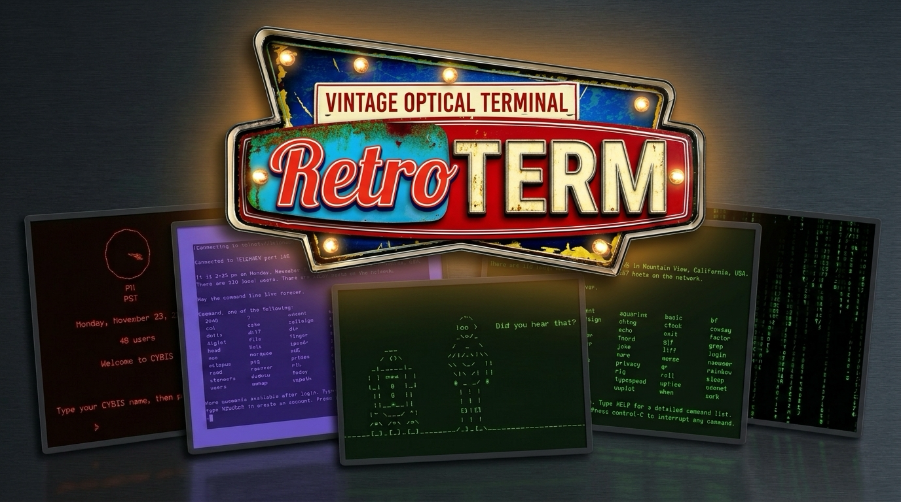
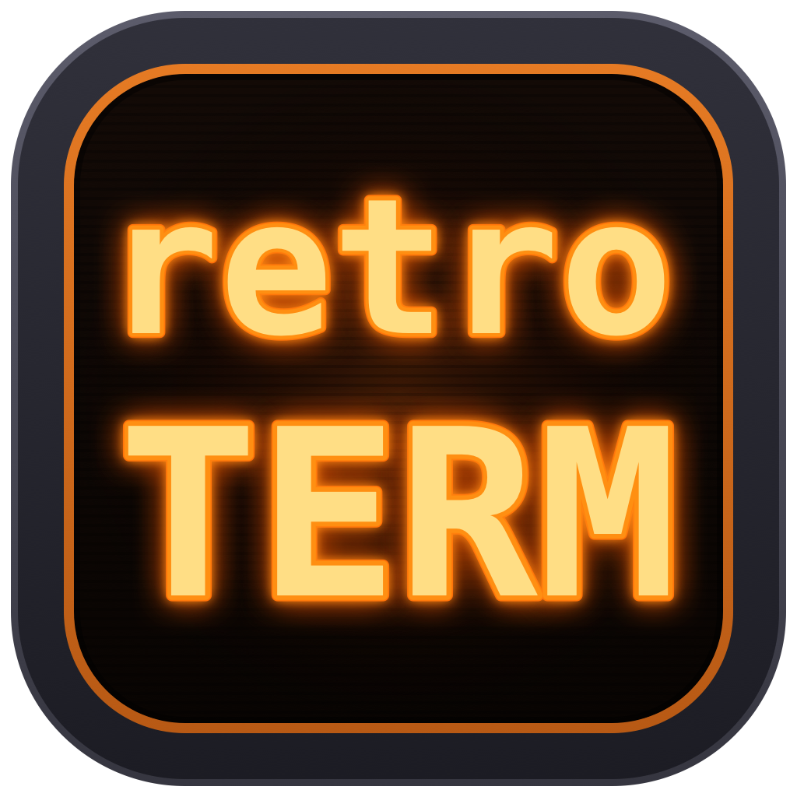

# RetroTerm (v2.3.0)

<div align="center">
  
</div>

## Latest Changes (v2.3.0)

- **Windows SFTP Mapped Drive Write-Back Fix**: Fixed local file modification tracking and remote SFTP write-back when opening and editing files from a WinFsp SFTP-mapped drive.
- **Matrix (1999) Digital Rain Screensaver**: Updated the Matrix screensaver with the 53-glyph 1999 repertoire, stationary grid, synchronized cross-dissolve mutations, ~1-in-5 highlighted heads, coordinated cursor stammer, independent deletion strings, and invisible prefixes.
- **Single-Source `VERSION` File**: Centralized version management via `VERSION` (`src/core/rt_version.h` auto-generated by CMake and `build_all.sh`).

## Latest Changes (v2.1.0)

- **Script Shortcuts**: Full quick-execution hotkey support for both standard and PLATO scripts on macOS (including `Ctrl`, `Alt`, `Shift`, `Cmd`, and `F1`–`F12`), plus PLATO key conflict warnings across macOS, Windows, and Linux.

## Latest Changes (v2.0.1)

- **PLATO System Beep Fix**: Wired `plato_terminal_t::beep_callback` to the native OS system alert (`NSBeep()` on macOS, `MessageBeep(MB_OK)` on Windows, matching Linux `rt_linux_audio_beep`) so PLATO `ECHO 0x7B` and MicroTutor beep commands produce audio across all platforms.

## Latest Changes (v2.0)

- **Linux Desktop Edition**: Native SDL2/OpenGL build for Linux `x86_64` and `ARM64` with the same display engines, menus, profiles, scripts, SFTP browser, and PTY support as macOS and Windows, shipped with a simple desktop installer.
- **Native PLATO Sessions**: New `PLATO` protocol in Quick Connect and Manage Profiles for connecting directly to PLATO hosts (e.g. Cyber1), with touch-panel input, PLATO keyboard profiles, PLATO scripts, and a local **MicroTutor** (Z80) runtime for booting `.mte` images.
- **Shell Picker for Local PTY**: Quick Connect and Manage Profiles list the shells actually installed on the current system (e.g. `zsh`/`bash` from `/etc/shells`, or Command Prompt, PowerShell, PowerShell 7, WSL, Git Bash, MSYS2, Cygwin on Windows).
- **Matrix Screensaver**: Optional idle screensaver with the classic digital rain, rendered in the style of the active display engine.
- **Context-Aware Menus**: The **SFTP** menu appears only in SSH sessions and the **Microtutor** menu only in PLATO sessions.
- **Local Terminal Engine (PTY)**: Native local shell sessions via POSIX `openpty` on macOS and Linux and Windows ConPTY alongside SSH and Telnet, selectable directly in Quick Connect and Manage Profiles.
- **Full Modern Terminal Emulation**: VT100/VT220, ANSI/xterm extensions, 256-color and 24-bit TrueColor, alternate screen buffer, mouse reporting (X10/SGR/URXVT), OSC 52 clipboard, full UTF-8/Unicode typography, DECSCUSR cursor styles, and bracketed paste.
- **macOS SFTP Mount (SSHFS Equivalent)**: Mount remote SFTP directories onto a native macOS folder path (`~/RetroTermMount` or custom mount point) via an integrated loopback WebDAV bridge and `mount_webdav`, matching Windows WinFsp SFTP drive mounting.
- **Connection Recovery & 30s Auto-Retry**: Modeless connection-issue dialog across macOS and Windows with clear diagnostics, immediate `Retry Now`, continuous 30-second auto-retry toggle, and clean `Abort`.
- **Profile Startup Scripts**: Per-profile `Startup Script` dropdown in Manage Profiles that executes automatically once the SSH, Telnet, or PTY session is established.
- **macOS Parity & Polish**: Screen text selection highlight with auto-copy HUD toast and right-click paste across all optical and Modern modes, single macOS Keychain vault unlock per session, and auto-connect on **New Window with Profile**.

[-orange.svg)](#)
[](#)
[](#)
[](#)

<div align="center">
  
</div>

**RetroTerm** is a native cross-platform terminal emulator for macOS, Windows, and Linux, combining a modern VT100/VT220/xterm parser (`libvterm`), SSH2 (`libssh2`), Telnet, Local PTY, native PLATO sessions, and SFTP file management with the physical vintage optical display simulations of **PlatoLives**.

Instead of rendering only flat pixels in a generic window, RetroTerm lets you work inside authentic optical hardware models—an **orange gas-plasma panel**, a **shadow-mask color CRT**, a **Tektronix 4014 Direct View Bistable Storage Tube (DVBST)**, a **DEC PDP-1 Type 30 precision CRT**, or a **Commodore 64 (VIC-II)**—while preserving the speed, ergonomics, and capabilities of a modern workstation terminal, including a dedicated **Modern Dynamic Grid** mode for crisp high-DPI Unicode coding sessions.

---

# What's new in v2.0

### Linux Desktop Edition
RetroTerm now runs natively on Linux (`x86_64` and `ARM64`) through SDL2 and OpenGL, sharing the same C11 core as the macOS and Windows apps:
- All 8 display engines, SSH / Telnet / PTY / PLATO sessions, profiles, keymaps, scripts, reconnect dialog, and Performance HUD.
- Built-in menu bar that can be auto-hidden (**View → Hide Menu Bar**) and revealed by moving the mouse to the top edge.
- SFTP browser plus **Map Remote Path as Linux Folder**, exposed through the local WebDAV bridge and mounted via GVFS (`gio mount`) when available.
- Desktop installer (`install.sh`) that copies the right binary for your architecture to `~/.local/bin/retroterm` and registers an application launcher.

### Native PLATO Sessions & MicroTutor
`PLATO` is now a first-class protocol next to SSH, Telnet, and PTY, using the PlatoLives terminal core with its native 512×512 display:
- Connect to PLATO hosts from Quick Connect or a profile (a **Cyber1.org** preset is included).
- Mouse clicks act as touch-panel input; PLATO-specific **keyboard profiles**, double-tap Access/Shift letters, selectable arrow-key modes (Standard / WASD / WASX / WADX), and a PLATO keyboard reference.
- Dedicated PLATO script manager and scripting reference.
- **Microtutor** menu: load and boot a local MicroTutor executable (`.mte`) on the built-in Z80 runtime, with an optional Z80 diagnostic log.

### Local Terminal (PTY) Alongside SSH & Telnet
RetroTerm now embeds a third first-class transport engine alongside SSH and Telnet: **Local Terminal (PTY)**.
- **macOS & Linux**: POSIX `openpty` spawning your login shell (`$SHELL`, e.g. `zsh`) with full `TERMIOS`, UTF-8 `LC_CTYPE`, and dynamic `TIOCSWINSZ` resize.
- **Windows**: Native Windows **ConPTY** (`CreatePseudoConsole`) spawning PowerShell, Command Prompt, or a custom shell executable.
- **Shell picker**: Quick Connect and the profile editor offer a dropdown of shells detected on the running system — entries from `/etc/shells` on macOS/Linux; Command Prompt, Windows PowerShell, PowerShell 7, WSL, Git Bash, MSYS2, and Cygwin on Windows when installed — plus a **Default** entry and a custom path.
- Full support in **Quick Connect**, **Manage Profiles**, **Connect with Profile**, and **New Window with Profile**.

### Modern Mode xterm & VT220 Completeness
In `Modern Dynamic Grid` (and throughout `libvterm` integration), RetroTerm supports:
- VT100 / VT220 and ANSI escape sequences, scroll regions (`DECSTBM`), and cursor addressing.
- **256-color** and **24-bit TrueColor** (`SGR 38;2;r;g;b` / `48;2;r;g;b`).
- **Alternate Screen Buffer** (`?1049h` / `?1049l`) for full-screen TUIs (`vim`, `htop`, `tmux`, `less`, `mc`).
- **Mouse Reporting** (`?1000`, `?1002`, `?1003`, `?1006` SGR) and mouse wheel scrolling.
- **OSC 52 Clipboard** integration, **OSC 0/2** dynamic window titles, **DECSCUSR** cursor shape/blink, **Focus Events** (`?1004`), and **Bracketed Paste** (`?2004`).
- Full **UTF-8 / Unicode** CoreText/DirectWrite rasterization with crisp vector Powerline and box-drawing glyphs.

### SFTP Browser & Remote Drive Mount (Windows + macOS)
- **Integrated SFTP File Browser** over active SSH sessions (upload, download, directory navigation, rename, mkdir, delete, permissions/details).
- **Windows SFTP Drive Mount**: Mount any SFTP path to a native Windows drive letter (`D:`–`Z:`) via WinFsp (`rt_sftp_vfs`).
- **macOS SFTP Mount Point**: Mount any SFTP path to a local macOS directory (`~/RetroTermMount` or custom folder) through RetroTerm's loopback RFC 4918 WebDAV bridge and native `/sbin/mount_webdav`, with Finder integration and clean unmount on disconnect.

### Non-Blocking Connection Diagnostics & 30s Auto-Retry
Inspired by PlatoLives' resilient connection architecture, network failures and unexpected drops display a theme-synchronized, non-blocking recovery window:
- **Clear Failure Classification**: Distinguishes DNS resolution errors, refused connections (server down/port closed), timeouts, unreachable hosts, authentication errors, host-key verification issues, and unexpected mid-session drops.
- **Retry Now**: Immediately re-attempts connection while preserving existing terminal scrollback/context.
- **Continuous 30s Auto-Retry**: Toggleable countdown timer that continuously retries every 30 seconds until connected or aborted.
- **Abort**: Cancels active retry timers and sockets cleanly, wipes temporary in-memory retry credentials, and returns offline.

### Profile Startup Scripts & Instant Profile Windows
- **Startup Script Selection**: Manage Profiles includes a **Startup Script** dropdown listing all saved automation scripts. When a profile is launched, its assigned script starts automatically as soon as the SSH, Telnet, or PTY session enters the connected state.
- **New Window with Profile (macOS & Windows)**: Opens a dedicated terminal window styled for that profile and initiates its saved connection immediately.
- **Preset Profiles**: The profile list includes ready-to-use presets (added if missing) — `Localhost (PTY)` in Modern mode, `Star Wars ASCII (Blinkenlights)` on Tektronix, `Telehack` on Real Plasma, and `Cyber1.org` over PLATO.

### Matrix Screensaver
**View → Matrix Screensaver** starts the classic falling-glyph digital rain on demand or after a period of inactivity (Disabled, 1, 2, 5, or 10 minutes; default 2 minutes, saved in settings). The rain follows the active display engine — green with write flare on Tektronix, orange plasma glow on PLATO modes, P7 radar phosphor on PDP-1, VIC-II blues on C64, film-accurate green in Modern, and random colors on the color CRT modes — and honors any active phosphor color override. Any key press, click, or mouse movement dismisses it without sending that input to the session.

---

# Display Engines

RetroTerm provides **8 selectable display modes** tailored for both vintage hardware fidelity and modern day-to-day terminal work:

1. **Real Plasma**: Gas-plasma panel simulation with configurable persistence decay (100 ms – 5000 ms), spatial distortion, and selectable phosphor overrides (Orange, P31 Green, P40 Amber, P4 White).
2. **Crisp Monochrome**: High-contrast sharp monochrome matrix emulation with instant response and zero geometric distortion.
3. **Crisp Color**: Sharp multi-color matrix display supporting ANSI/xterm palettes.
4. **Real Color CRT**: RGB phosphor CRT pipeline featuring adjustable beam profile, phosphor decay, scanlines, and tube curvature distortion.
5. **Real Tektronix 4014 (DVBST)**: Direct-view bistable storage tube simulation with selectable baud pacing, green-tint P31 phosphor glow, erase-flash physics, and accurate background noise toggle.
6. **DEC PDP-1 Type 30 (1964)**: Precision point-plotting CRT with P7 cascade phosphor simulation (cyan prompt flash shifting into golden-amber persistence), 1961 MIT Codeword / 1964 Type 33 fonts, and configurable refresh rate (5–60 Hz).
7. **Commodore 64 (VIC-II)**: Authentic 8-bit display with RF composite, Commodore 1702 CRT, and Crisp Hires presets, selectable 12.5% border modes (including Turbo Loader Border FX), and Classic Blue / Multi-Color / Amber / Green palettes.
8. **Modern Dynamic Vector Grid**: Resizable variable-column/row grid paired with Apple Metal (macOS), Direct3D 11 (Windows), or OpenGL (Linux) GPU text rendering, configurable monospace font family/size, cursor styles (Block, Underline, Bar), and full TrueColor / UTF-8 support. Not available in PLATO sessions.

---

# Protocols, Security & Ergonomics

| Capability | Details |
| :--- | :--- |
| **SSH2 Transport** | `libssh2` with non-blocking sockets, OpenSSH host-key (`known_hosts`) verification prompt, password and private-key auth, dynamic window resize (`PTY` window-change) |
| **Telnet Transport** | Asynchronous RFC 854 / 855 / 1073 (`NAWS`) / 1091 (`TTYPE`) client with clean disconnect/reconnect tracking |
| **PLATO Transport** | Native PlatoLives terminal session over TCP with touch-panel input, PLATO keymaps, scripts, and local MicroTutor (Z80) execution |
| **Local PTY** | POSIX `openpty` on macOS and Linux, Windows `ConPTY` on Windows 10/11, with a per-profile shell picker |
| **Credential Vault** | Encrypted storage via **macOS Keychain** (`rt_mac_keychain`) and **Windows Credential Manager**, plus `rt_ssh_secure_zero()` memory wiping. On Linux, saved passwords are kept obfuscated (not encrypted) in `~/.retroterm/credentials.ini` |
| **Direct Copy & Paste** | Drag mouse anywhere on the screen (both Vintage Optical and Modern modes) to highlight and auto-copy with an on-screen HUD toast; right-click to paste directly |
| **Custom Keymaps & Scripts** | Multi-profile keyboard remapping (`Cmd+K` / `Ctrl+K` reference) and state-aware automation scripts (`wait_text`, `send`, `wait`, variables, loops) |

---

# Menus and Navigation

Consistent menu structure across macOS, Windows, and Linux:

- **Connection**: Quick Connect, Connect Default, Connect with Profile, Manage Profiles, New Window, New Window with Profile, Disconnect, Close Window, Quit
- **SFTP** (SSH sessions only): SFTP File Browser, Map SFTP Path as Mount Point / Drive / Linux Folder, Unmount SFTP Path / Drive
- **Microtutor** (PLATO sessions only): Load and Boot from MTE, Z80 Diagnostic Log
- **Scripts**: Run saved scripts, Manage Scripts, Scripting Reference (PLATO scripts in PLATO sessions)
- **Keyboard**: Select Keyboard Layout, Manage Keyboard Profiles, Keyboard Reference (PLATO keyboard profiles, double-tap, and arrow modes in PLATO sessions)
- **View**: All 8 Display Engines, per-engine hardware options (Plasma/CRT/Tektronix/PDP-1/C64/Modern Font & Cursor), Window Size presets (1×–4× / Aspect Fit), Full Screen (`F11`), Performance HUD (`F12`), Matrix Screensaver, Override Phosphor Color, Hide Menu Bar (Linux)
- **Edit**: Copy Selection, Copy Screen Text, Paste, Live Text Buffer, Cancel Paste, Send Control Signals / Function Keys / Editing Keys
- **Tools**: Diagnostic Log, Renderer Performance Log
- **Help**: Keyboard Reference, Scripting Reference, About RetroTerm

---

# Supported Systems

| Platform | Interface | GPU / System Backend |
| :--- | :--- | :--- |
| **macOS 13+ (Apple Silicon & Intel)** | Native Cocoa App (`RetroTerm.app`) | Apple Metal 60 FPS, CoreText, Keychain, `openpty`, WebDAV (`mount_webdav`) |
| **Windows 10/11 (x86_64)** | Native Win32 Desktop | Direct3D 11, DirectWrite, WinCNG/Credential Manager, ConPTY, WinFsp |
| **Windows 10/11 (ARM64)** | Native Win32 Desktop (AArch64) | Direct3D 11, DirectWrite, WinCNG/Credential Manager, ConPTY, WinFsp |
| **Linux (x86_64 & ARM64)** | SDL2 Desktop App | OpenGL, SDL2, OpenSSL (`libcrypto.so.3`), `openpty`, GVFS (`gio`) for SFTP folder mounts |

---

# Building

RetroTerm builds natively on macOS with CMake and cross-compiles Windows and Linux `x86_64` / `ARM64` binaries using `zig cc`.

### Build All Platforms (Windows, Linux & macOS)

Requirements on macOS: Xcode Command Line Tools, CMake, `libssh2`, and `zig`. The Linux targets additionally need SDL2 and OpenSSL headers (e.g. from Homebrew); if they are missing, the Linux step is skipped.

```bash
./build_all.sh
```

Build outputs and verification:
- `build/RetroTerm-windows-x86_64.exe`
- `build/RetroTerm-windows-arm64.exe`
- `build/RetroTerm-linux-x86_64`
- `build/RetroTerm-linux-arm64`
- `build/RetroTerm-linux-desktop-install.tar.gz`
- `build-mac/RetroTerm.app`
- Runs the full `ctest` suite automatically against all core and transport modules.

### Installing on Linux

```bash
tar -xzf RetroTerm-linux-desktop-install.tar.gz
./linux_desktop_install/install.sh
```

The Linux binaries require SDL2, OpenGL, and OpenSSL 3 runtime libraries.

### Native macOS CMake Build & Test Only

```bash
cmake -S . -B build-mac
cmake --build build-mac -j
ctest --test-dir build-mac --output-on-failure
```

---

# Technical Details

| Component | Details |
| :--- | :--- |
| **Core Architecture** | Portable C11 core shared identically across macOS, Windows, and Linux UIs |
| **VT Engine** | `libvterm` (VT100 / VT220 / xterm-256color / TrueColor / OSC / Mouse / AltScreen) |
| **Optical Pipeline** | `PlatoLives` C11 renderers (`Real Plasma`, `CRT`, `Tektronix 4014`, `PDP-1 Type 30`, `C64 VIC-II`) |
| **Modern Renderer** | GPU-accelerated texture atlas (`rt_modern` + CoreText / DirectWrite glyph rasterization) |
| **SSH & SFTP** | Asynchronous non-blocking `libssh2` + virtual filesystem layer (`rt_sftp_vfs`) |
| **macOS Drive Bridge** | Multi-threaded loopback RFC 4918 WebDAV server (`rt_webdav_sftp`) + `/sbin/mount_webdav` |
| **Connection Diagnostics** | Shared state classifier (`rt_conn_diag`) + modeless Cocoa / Win32 auto-retry dialogs |
| **Test Suite** | 15 automated CTest suites (`smoke`, `vt`, `adapter`, `all_engines`, `ssh`, `sftp_vfs`, `script`, `keymap`, `telnet`, `pty`, `settings`, `modern`, `conn_diag`, `plato_core`, `screensaver`) |
